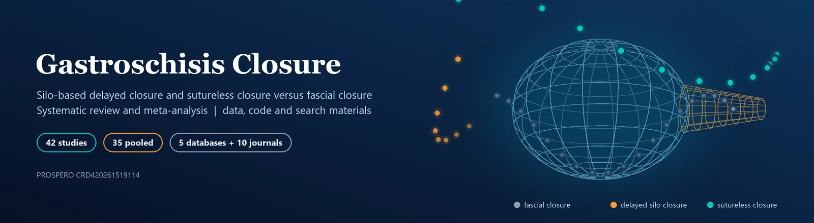
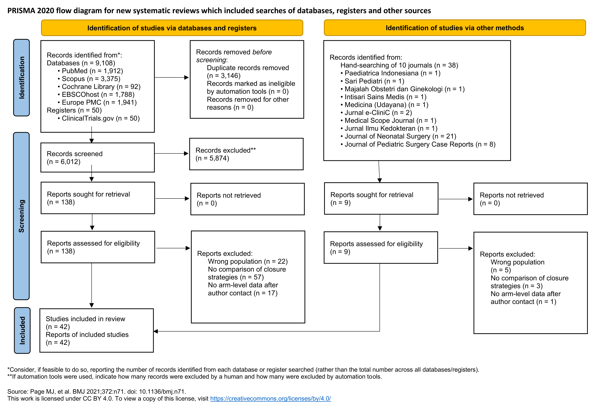
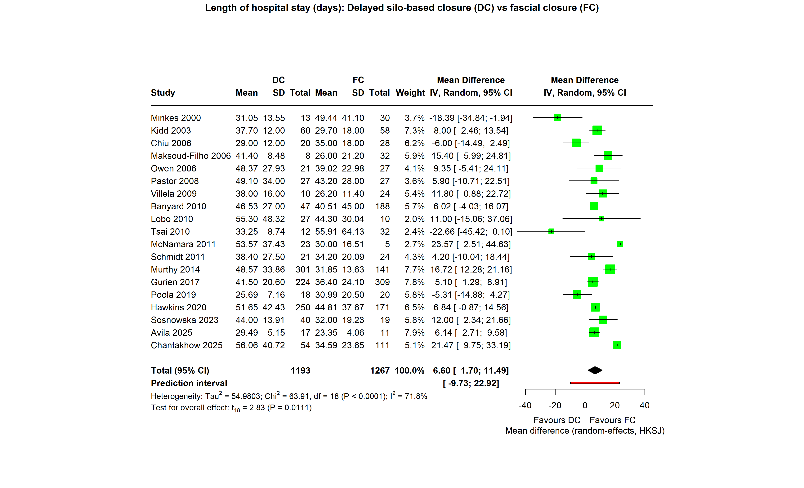
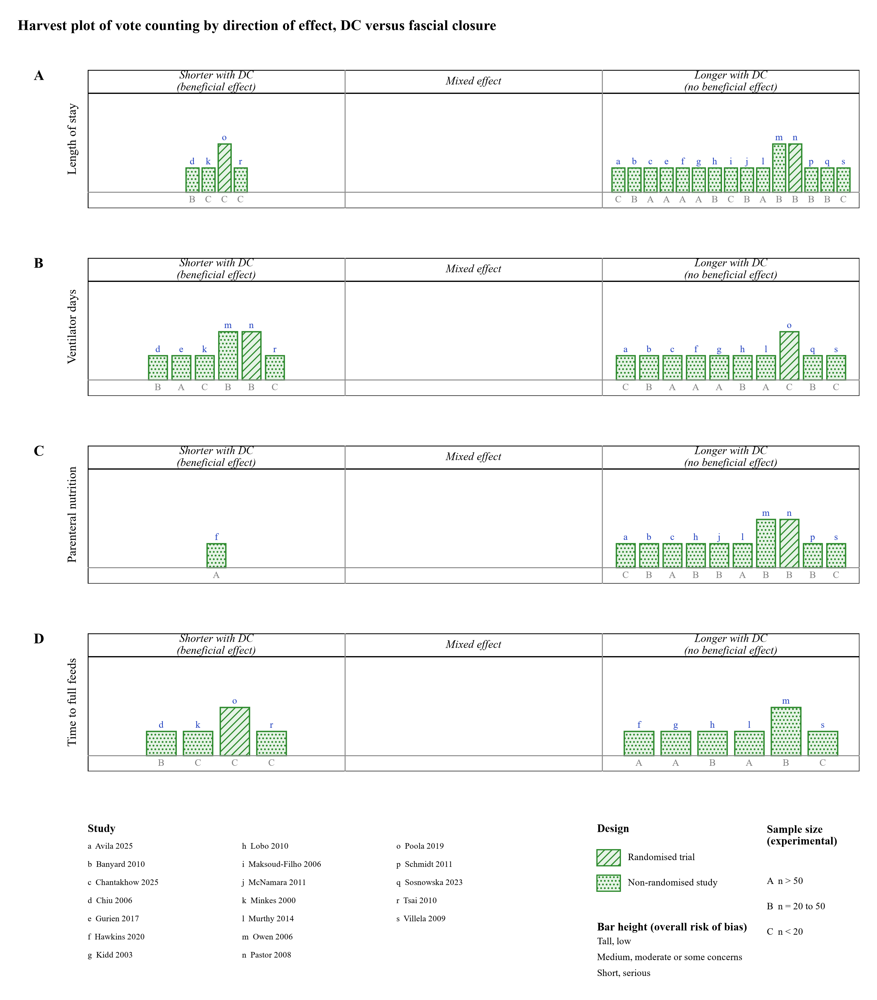

<p align="center">
  
</p>

<h1 align="center">Gastroschisis closure strategies</h1>

<p align="center">
  Silo-based delayed closure and sutureless closure compared with fascial closure in neonates with gastroschisis:<br>
  <b>a systematic review and meta-analysis</b><br>
  Vita Indriasari, Karina Zulkarnain Balia, Rizki Diposarosa, Dikki Drajat Kusmayadi, Emiliana Lia<br>
  Department of Pediatric Surgery, Faculty of Medicine, Universitas Padjadjaran
</p>

<p align="center">
  
  
  
  
  
  
</p>

**OSF registration:** https://doi.org/10.17605/OSF.IO/WB3F4

**Website:** https://sharing-123.github.io/gastroschisis-closure-sr-ma/

Data, analysis code and search materials behind the manuscript. Everything needed to rerun the pooled estimates, the sensitivity analyses, the GRADE tables and the figures is here.

## Main findings

| Comparison (vs fascial closure) | Outcome | Studies | Effect (95% CI) | Certainty |
|---|---|---|---|---|
| Delayed silo closure | Length of stay, days | 19 | +6.6 (1.7 to 11.5), prediction interval -9.7 to 22.9 | Very low |
| Delayed silo closure | Ventilator days | 16 | +2.9 (0.1 to 5.6) | Very low |
| Delayed silo closure | Parenteral nutrition, days | 11 | +7.0 (2.7 to 11.3) | Very low |
| Delayed silo closure | Sepsis, RR | 10 | 1.00 (0.79 to 1.27) | Low |
| Sutureless closure | Length of stay, days | 8 | +1.4 (-6.2 to 8.9) | Very low |
| Sutureless closure | Ventilator days | 5 | -1.5 (-2.4 to -0.5) | Low |
| Sutureless closure | Umbilical hernia, RR | 2 | 3.11 (0.34 to 28.18) | Very low |

Silo-based closure goes with longer stay, ventilation and parenteral nutrition, but 31 of 32 non-randomized studies carry serious risk of bias from confounding by indication. Sutureless closure shortens ventilation without changing stay.

## Evidence at a glance

<p align="center">
  
</p>

<p align="center">
  
  
</p>

## Method in brief

| Step | What was done |
|---|---|
| Search | PubMed, Scopus, Cochrane Library, EBSCOhost (MEDLINE with Full Text), Europe PMC, ClinicalTrials.gov, and ten journals not well covered by the databases |
| Records | 9,158 database and register records, 38 hand-searched, 42 studies included, 35 with arm-level data, 7 in a narrative synthesis |
| Model | Pairwise random-effects meta-analysis (REML, Hartung-Knapp intervals, prediction intervals), with network and multilevel models as checks |
| Medians | Box-Cox conversion (seed 20261123), Wan formulas as sensitivity |
| Bias | ROBINS-I and RoB 2 |
| Certainty | GRADE, with explicit rules for downgrading |

## Repository map

| Folder | Contents |
|---|---|
| `data/` | Arm-level extraction, per-report decisions, reference list |
| `analysis/` | Pooled results, GRADE and ROBINS-I tables, analysis datasets, fitted models, all figures |
| `scripts/` | R and Python code for arms, models, GRADE, risk of bias, harvest plots, manuscript tables |
| `search/` | Boolean strings, journal scans and search tests |
| `supplementary/` | Tables S1 and S2, Boolean test report, analysis plan, extraction workbook, PRISMA diagram |
| `manuscript/` | Current manuscript draft |

Full-text PDFs are not included because of publisher copyright. `supplementary/Full Text Tracker Gastroschisis.xlsx` lists every report.

## Reproduce

```powershell
Rscript scripts/run_analysis.R   # pooled models, sensitivity analyses, network
Rscript scripts/run_figures.R    # forest and funnel plots
Rscript scripts/run_grade.R      # GRADE profile
python scripts/harvest.py        # harvest plots
```

R packages: meta, metafor, netmeta, estmeansd, gt. Paths inside the scripts point to the original project folder and need adjusting.

## Cite

See `CITATION.cff`. Zenodo archive: https://doi.org/10.5281/zenodo.24486543

## Credits

Banner anatomy: Ecorche (BodyParts3D, Z-Anatomy), CC BY-SA 4.0. See `assets/NOTICE.md`.

## License

Code under MIT. Data and text under CC BY 4.0. See `LICENSE`.
